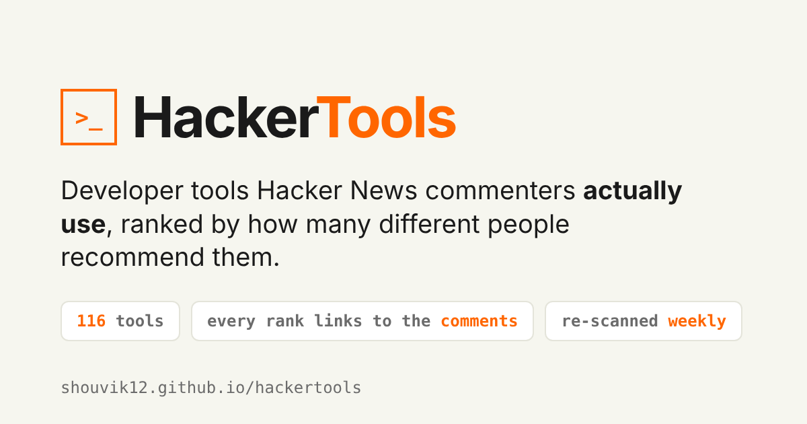

<p align="center"><a href="https://shouvik12.github.io/hackertools/"></a></p>

<p align="center">
<a href="https://shouvik12.github.io/hackertools/"><b>Open HackerTools →</b></a> ·
<a href="#how-a-recommendation-is-counted">How it counts</a> ·
<a href="#run-it-yourself">Run it</a> ·
<a href="#add-a-tool">Add a tool</a>
</p>

Hacker News threads are full of people saying which tools they actually use. HackerTools collects those comments for about 120 developer tools and ranks each tool by how many **different people** recommended it. Every number links back to the comments behind it, so you can read the reasons, not just the score.

Inspired by [@karpathy](https://x.com/karpathy)'s HackerTube (videos recommended in HN comments), and by [HackerBooks](https://hackerbooks.org) (books).

## What you get

- **A ranking by people, not mentions.** One person posting about Nix forty times counts once.
- **The comments behind every rank**, with the clearest recommendation shown first.
- **Trending**: which tools people are recommending most in the last two years.
- **Search and categories**: editors, terminal, Git, infra, data, self-hosted and more.
- **Shareable links**: `#cat=Editors`, `#sort=recent`, or a single tool like `#tool-neovim`.
- **Fresh every week.** A GitHub Action re-scans HN every Monday.

## How a recommendation is counted

A comment counts for a tool only when all of these hold:

1. It names the tool (case-sensitive for common words like Zed, Bun, fish or bat).
2. A recommendation phrase sits **right next to** the name: "I use", "switched to", "daily driver", "highly recommend"…
3. It isn't negative: "never use", "stopped using", "moved back to", "migrate away" don't count.
4. The tool isn't the loser of a comparison: in "better than X", "replaced X" or "after giving X a try", X gets nothing.
5. It isn't in a "Who is hiring" thread, where tools are job requirements, not recommendations.
6. For ambiguous names (AeroSpace, Alfred, asdf, fd, delta…), the comment also has a context word such as "window manager" or "version manager".

Then it counts **distinct commenters**, searching both the most relevant and the newest comments, so long-lived tools like Emacs and Docker show recent opinions too.

This is still keyword matching. It's a strong signal, not a verdict, and it will sometimes be wrong. If you spot a bad match, [open an issue](https://github.com/shouvik12/hackertools/issues).

## Run it yourself

```bash
python3 scan_tools.py --only "Neovim,Ghostty"   # quick test on a few tools
python3 scan_tools.py                           # full scan (about 40–80 min)
python3 -m http.server 8000                     # open http://localhost:8000
```

No API key and no dependencies: Python standard library plus the public [HN Algolia API](https://hn.algolia.com/api).

| File | What it does |
|---|---|
| `scan_tools.py` | Searches HN comments, filters them, writes `tools.json` |
| `tools.json` | The data: counts, years, and up to 12 comments per tool |
| `index.html` | The static site; reads `tools.json`, no build step |
| `.github/workflows/refresh.yml` | Re-scans every Monday and commits the new `tools.json` |

**Deploy:** push to GitHub and turn on Pages. That's it.

## Add a tool

The quickest way is to [suggest it in an issue](https://github.com/shouvik12/hackertools/issues/new?title=Add%20tool%3A%20). Or add one line to `SEED` in `scan_tools.py`:

```python
("Ghostty", "Terminal", "https://ghostty.org", []),
# name, category, homepage, [other spellings], True if the name is a common word
```

If the name is ambiguous, add a context pattern to `CONTEXT` so it only matches the right comments.

## Also on DEV·TV

HackerTools runs as a channel on [DEV·TV](https://shouvik12.github.io/devtv/), a retro TV for developers. It cycles through the top tools with a real HN quote on each, so you can leave it on in a tab.

## Who made it

Built by [@shouvik_palit](https://x.com/shouvik_palit). Stars and issues help it improve.
